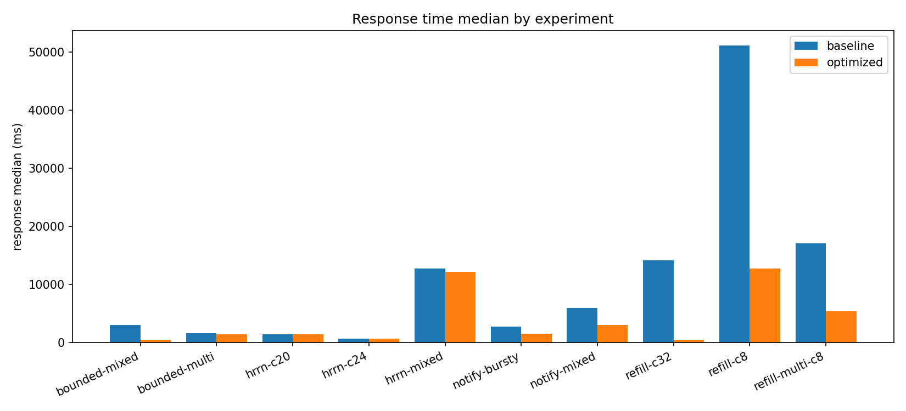
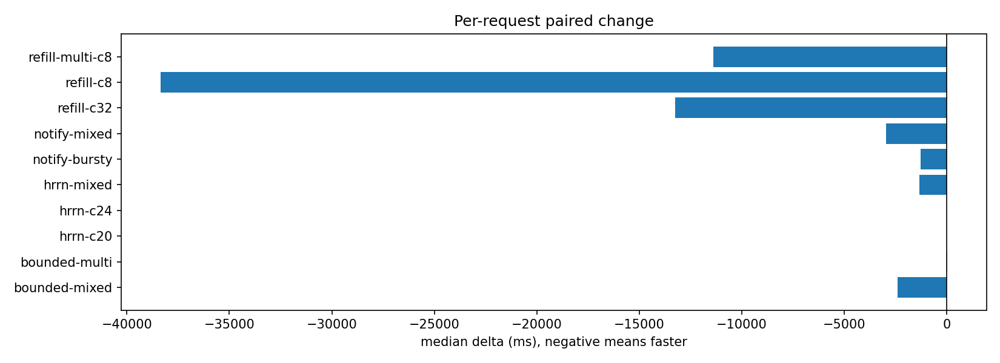
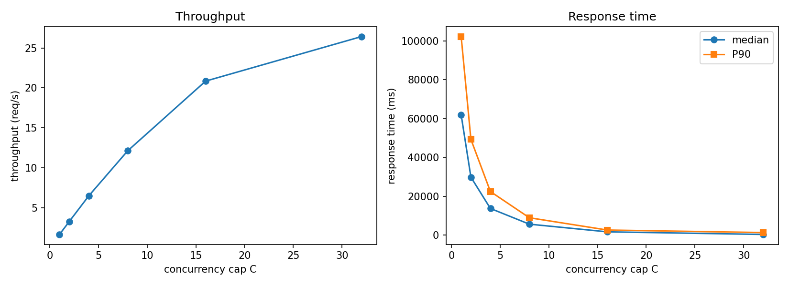

# AIOS 请求调度优化实验报告

日期：2026年11月27日

## 一、目标与范围

多个 Agent 并发调用大模型时，请求的时长和到达时间都不一致。本次工作针对三个等待来源：

1. 同一模型组内，先完成的请求要等最慢的请求，结果才统一写回。
2. 新到的请求要等当前批次结束，才能进入下一轮收集。
3. 有排队时，先执行哪一个请求。

基线取 `dev` 分支合并测量环境之后的状态。所有对照在同一台机器上完成，使用模拟后端，没有接入真实 API。

## 二、测量方法

### 2.1 假后端与场景

`benchmark/mock_backend.py` 继承 `LLMAdapter`，只覆盖最底层的一次模型调用。调度器、队列、线程池、结果写回和调用方唤醒都走原代码。

每个请求的到达时间、服务时间、故障类型在场景生成阶段一次算好并写盘。同一份场景在不同分支上生成的请求序列和服务时间完全一致，因此前后对比的差值可以归因到调度行为。服务时间包含对数正态抖动，配置里还可以注入错误、超时和偶发慢请求。

### 2.2 时间点与指标

每个请求记录七个时间点：发起、进入队列、被调度器取走、工作线程开始执行、后端返回、结果通知、调用方拿到结果。由此得到：

| 指标 | 含义 |
| --- | --- |
| 排队等待 | 入队到被调度器取走 |
| 调度等待 | 取走到工作线程开始执行 |
| 服务时间 | 后端实际耗时 |
| 通知延迟 | 后端返回到调用方被唤醒 |
| 响应时间 | 发起请求到调用方拿到结果 |
| 放大倍数 | 响应时间除以服务时间 |

汇总指标包括吞吐量、总完成时间、峰值并发、批次大小、错误和重复通知。

### 2.3 对照方法

每条分支放在独立的 worktree 中。同一组对照的两次运行交替顺序，第 1 轮先基线后优化，第 2 轮反过来，共 3 轮，抵消机器状态随时间的漂移。

因为场景固定，同一个请求在两个分支上的服务时间相同，所以按 `(轮次, 请求编号)` 配对，计算每个请求的差值，再统计差值的中位数和 P90。

噪声基准用同一条分支对自身跑两轮得到：响应时间差值中位数 -0.2 ms，P90 2.4 ms。后续结论的差值都明显大于这个范围。

### 2.4 实验规模

除特别说明外，每组 500 个请求，多步负载约 600 个请求，重复 3 轮。五个负载：

| 负载 | 请求数 | 到达方式 |
| --- | --- | --- |
| 混合 | 500 | 泊松，40 请求每秒 |
| 突发 | 500 | 每 300 毫秒 50 个 |
| 匀速 | 500 | 匀速，20 请求每秒 |
| 多步 | 595 | 200 个任务，每个 2 到 4 步 |

## 三、改动

### 3.1 单请求及时返回

原版在一个模型组全部结束后，才逐个写回结果并唤醒调用方。改动后，组内每个请求自己的线程一结束就立即写回并唤醒，组线程仍然等待全部结束，但调用方不再陪跑。

写回逻辑统一到 `_notify_syscall`，并保证每个请求只通知一次。

### 3.2 有界并发持续补位

原版没有并发上限，请求按批次执行。新调度器维护等待列表和在途集合：

- 同时在跑的后端调用不超过 C。
- 任何一个请求结束就立即补下一个。
- 新请求到达时如果有空位，直接开始执行。
- 关闭时停止接收新请求，并处理完已经排队和在途的请求。
- 超时后先通知调用方，底层调用继续跟踪，实际结束才释放名额。

### 3.3 耗时估计与响应比选择

按模型、输入长度分桶和输出上限分组，用已完成请求的服务时长滑动均值估计耗时。输入长度用字符数除以 4 粗估。冷启动使用固定值，运行中只使用真实完成的请求更新。

补位时选择响应比最高的请求，响应比等于 1 加等待时长除以预计耗时。等待时间持续增长，长期等待的长请求不会一直输给新到达的短请求。

另外增加两组分析用的估计器：固定值估计，以及直接读取场景真实耗时的估计器，后者只用于衡量估计准确度的上界。

### 3.4 对照组

固定并发分批版：批次大小限制为 C，每批全部结束后才收集下一批。它和持续补位使用相同的并发上限，用来单独衡量补位机制的作用。

## 四、结果

### 4.1 汇总

| 实验 | 基线中位数 | 优化中位数 | 差值中位数 | 差值 P90 | 基线吞吐 | 优化吞吐 | 基线并发 | 优化并发 |
| --- | --- | --- | --- | --- | --- | --- | --- | --- |
| 及时返回，混合 | 5938 ms | 3039 ms | -2971 ms | -1863 ms | 25.8 | 25.8 | 259 | 259 |
| 及时返回，突发 | 2714 ms | 1503 ms | -1290 ms | -798 ms | 92.5 | 96.8 | 250 | 250 |
| 持续补位，C=32 | 3039 ms | 456 ms | -2421 ms | -418 ms | 25.9 | 31.3 | 259 | 32 |
| 补位对分批，C=32 | 14110 ms | 457 ms | -13270 ms | -2510 ms | 10.2 | 31.3 | 32 | 32 |
| 补位对分批，C=8 | 51125 ms | 12748 ms | -38355 ms | -6160 ms | 3.9 | 11.5 | 8 | 8 |
| 补位对分批，多步 C=8 | 17105 ms | 5388 ms | -11386 ms | -4024 ms | 7.8 | 18.7 | 8 | 8 |
| 有界并发，多步 C=16 | 1574 ms | 1450 ms | +6 ms | +934 ms | 36.3 | 34.6 | 121 | 16 |
| 响应比，过载 C=8 | 12739 ms | 12160 ms | -1337 ms | +11826 ms | 11.5 | 11.1 | 8 | 8 |
| 响应比，C=20 | 1397 ms | 1403 ms | -1 ms | +577 ms | 26.0 | 24.9 | 20 | 20 |
| 响应比，C=24 | 705 ms | 709 ms | 0 ms | +133 ms | 29.0 | 28.2 | 24 | 24 |





表中的中位数两列是各自请求分布的中位数，差值列是逐请求配对后的中位数，两者不必相等。判断效果以差值列为准。

### 4.2 及时返回

混合负载下响应时间中位数下降 2971 ms，其中通知延迟下降 2960 ms，排队等待和服务时间基本不变。突发负载下通知延迟下降 1204 ms，响应时间下降 1290 ms。

吞吐和峰值并发没有变化。这项改动只改变结果交付的时间，不改变执行方式。

### 4.3 持续补位

同样是 C=8，分批版响应中位数 51.1 秒，持续补位 12.7 秒，差值 38.4 秒。多步负载在 C=8 下，分批版 17.1 秒，持续补位 5.4 秒。

C=32 时差距仍然存在：14.1 秒对 0.46 秒。容量充足并不消除批次边界，因为分批版要等整批最慢的请求结束，批次越大，尾部拖得越久。

相对无上限的基线，C=32 的持续补位把吞吐从 25.9 提升到 31.3 请求每秒，峰值并发从 259 降到 32。

多步负载 C=16 时，持续补位与无上限批次的响应中位数配对差值为 +6 ms，基本持平，吞吐从 36.3 降到 34.6，下降 4.5%，峰值并发从 121 降到 16。这一组说明，当容量充足时，补位的主要价值是控制并发，而不是降低延迟。

### 4.4 响应比选择

响应比选择只有在队列存在时才有作用：

- C=24 时排队等待中位数只有 70 ms，响应差值 0 ms。
- C=20 时排队等待约 718 ms，整体差值 -1 ms，短请求 -20 ms，P90 增加 577 ms。
- C=8、40 请求每秒时系统已经饱和，整体中位数下降 1337 ms，但 P90 增加 11826 ms，吞吐从 11.5 降到 11.1。

过载时，响应比把等待时间从一部分请求转移到另一部分请求。中位数改善，尾部显著变差。稳定负载下收益很小，因为当前负载的输出长度与输入长度、输出上限基本无关，耗时估计只能学到分组均值，响应比接近按等待时间排序，和 FIFO 差别不大。

### 4.5 估计质量

固定估计、滑动均值和真实耗时三种估计器，500 个请求、C=8、单次运行：

| 估计器 | 短请求中位数 | 长请求中位数 | 全部中位数 | 全部 P90 | 预测绝对偏差中位数 |
| --- | --- | --- | --- | --- | --- |
| 固定值 | 10756 ms | 14420 ms | 12727 ms | 27083 ms | 285 ms |
| 滑动均值 | 10980 ms | 13491 ms | 12127 ms | 29126 ms | 326 ms |
| 真实耗时 | 1350 ms | 8490 ms | 3119 ms | 20639 ms | 0 ms |

固定值估计等价于按等待时间排序，短请求和长请求的中位数接近。滑动均值把整体中位数降低了约 600 ms，但短请求没有改善，P90 反而更差。真实耗时的短请求中位数是 1350 ms，说明估计准确时收益很大。

当前负载的预测绝对偏差中位数约 326 ms，接近服务时间中位数，估计器无法有效区分长短请求。滑动均值的收益主要来自长请求被推迟得更少，而不是短请求被优先执行。

### 4.6 容量

持续补位在混合负载上扫 C，200 个请求，单次运行：

| C | 吞吐 req/s | 总完成时间 | 响应中位数 | 响应 P90 |
| --- | --- | --- | --- | --- |
| 1 | 1.65 | 121.5 s | 61.96 s | 102.3 s |
| 2 | 3.26 | 61.3 s | 29.89 s | 49.3 s |
| 4 | 6.47 | 30.9 s | 13.77 s | 22.5 s |
| 8 | 12.12 | 16.5 s | 5.69 s | 8.99 s |
| 16 | 20.85 | 9.59 s | 1.74 s | 2.66 s |
| 32 | 26.43 | 7.57 s | 0.40 s | 1.36 s |



吞吐随 C 近似线性上升，C=32 时到达率成为瓶颈。C 小于 8 时系统饱和，响应时间主要由排队决定。

## 五、正确性测试

`python -m benchmark.selftest` 覆盖：

1. 场景生成可复现，服务时间与参数一致。
2. 选择规则的单元检查：FIFO、预计最短优先、响应比。
3. 单请求七个时间点齐全且单调递增。
4. 并发上限和及时返回。
5. 多步任务的每一步都能送达。
6. 错误、超时和正常请求的结果归属正确，每个请求只通知一次。
7. 故障期间峰值并发不超过上限。
8. 超时请求在到期时收到 408，后端调用继续执行到实际结束。
9. 指标之间的关系合理。
10. 关闭时停止接收新请求，在途请求完成并唤醒调用方。

当前全部通过。

## 六、讨论

三项改动的收益来源不同：

- 及时返回只影响通知延迟，不改变吞吐，适合单独作为一个工程改进。
- 持续补位影响排队，是三项里幅度最大的一项，在分批机制下尤为明显。
- 并发上限影响吞吐和资源占用，与补位是两件事。补位与上限组合可以在相同吞吐下把峰值并发降低一个数量级。
- 响应比选择依赖队列长度和估计质量。当前负载下收益有限，过载时还有尾部代价。

从工程取舍看，前两项可以默认开启。第三项建议在估计质量得到验证之后再启用，或者先在低优先级请求上使用。

## 七、限制

1. 没有真实 API 验证。没有可用额度和本地模型，模拟后端用固定睡眠代替网络调用。场景里有对数正态抖动和偶发慢请求，但这不等于真实服务的波动。
2. 只在一台机器上测量，绝对时间不可跨机器比较。对照采用交替运行和配对差值，结论只对本机环境成立。
3. 负载规模有限，每组 500 个请求，实际 Agent 系统可能更长、更不均匀。
4. 耗时估计的输入特征较弱，当前负载的输出长度与请求参数基本无关。真实负载中如果输出长度和 `max_tokens`、提示类型相关，估计质量会更高，响应比的收益也会更大。
5. 多组实验的并发上限是人为选择的，C=8、16、20、24、32 分别对应过载、接近饱和和容量充足。结论需要连同 C 一起理解。

## 八、结论

1. 单请求及时返回能显著降低响应时间，不改变吞吐，改动范围小，可以默认开启。
2. 有界并发持续补位在分批机制下带来最大幅度的延迟改善，同 C 下响应中位数下降 38.4 秒（C=8），并在容量充足时提升吞吐。
3. 并发上限是控制资源的手段，与补位配合可以在吞吐基本不变的情况下把峰值并发从 121 降到 16。
4. 响应比选择在有队列时可以把等待时间向短请求倾斜，但当前估计质量不足，整体收益有限，过载时尾部代价明显。需要更可预测的负载特征或更好的估计器。
5. 超时、关闭、故障隔离和通知次数通过正确性测试。

## 附：分支与复现

| 分支 | 内容 |
| --- | --- |
| `exp/baseline` | 测量环境和原版调度 |
| `exp/notify` | 加单请求及时返回 |
| `exp/batched` | 固定并发分批对照 |
| `exp/bounded` | 加有界并发持续补位 |
| `exp/hrrn` | 加耗时估计和响应比选择 |
| `exp/configs` | 全规模实验配置 |
| `report` | 本报告和图表 |

复现一组对照：

```bash
python -m benchmark.ab \
  --baseline-dir /path/to/baseline-worktree \
  --opt-dir /path/to/optimized-worktree \
  --config benchmark/experiments/mixed_500.yaml \
  --rounds 3 \
  --out results/repro
```

图表由 `benchmark/plot.py` 生成，依赖 matplotlib。仓库的 `requirements.txt` 没有包含，需要单独装进虚拟环境：

```bash
uv pip install --python .venv/bin/python matplotlib
```
